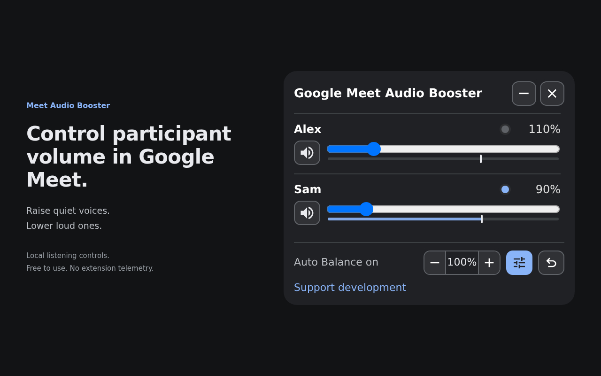

# Meet Audio Booster

Per-participant playback volume controls for Google Meet. Preferences stay in browser `localStorage`; the extension has no telemetry, makes no background network requests, and does not transmit meeting data.

## Install and use

[Install from the Chrome Web Store](https://chromewebstore.google.com/detail/meet-audio-booster/jhfekklmjikhcliimjcchapimohlmhaf). All extension functionality is free.

1. Install the extension in a supported Chromium browser, then reload any already-open Google Meet tab.
2. Join a Google Meet call and use each participant's slider or mute button to adjust what **you** hear. Start at 100% and raise volume gradually.
3. Use the toolbar button to reopen a hidden panel; use the Reset button (↶) to return the listed participants to 100%.



## Troubleshooting and support

- No panel: confirm the tab is on `meet.google.com`, reload after installing, and click the extension toolbar button.
- No participants: join the call and wait for remote participants. The extension cannot adjust your microphone or other people's playback.
- A setting seems inactive: speaker handoffs, overlapping speech or uncertain speaker/stream association can return playback to 100%. The same routing policy applies whether the meeting tab is visible or in the background. Browser restrictions or meeting changes can also prevent audio interception; see the limitations below.
- Auto Balance is learning: it needs several seconds of fresh, confidently attributed speech from a participant before adjusting their volume. Adjustments happen gradually during usable speech; silence, overlap and uncertain attribution pause them.
- Preferences: clear Google Meet site data to remove local settings; uninstalling alone may leave them behind.

[Get help or report an issue](https://github.com/andreclemente/meet-audio-booster/issues) · [Open a new issue](https://github.com/andreclemente/meet-audio-booster/issues/new). Include browser/extension versions and reproduction steps, not private meeting details or participant names.

Optional: [Buy Me a Coffee](https://buymeacoffee.com/andreclemente) to support development. Donations do not unlock features; all extension functionality remains free. Clicking the panel's Support development link opens this external site in a new tab under its own privacy policy and terms. No participant or meeting data is appended to the URL; the link uses `noopener noreferrer` and `no-referrer`. No support widget or request loads before you click.

## Features

- Per-participant 0–600% controls, a mute button that restores the previous volume when unmuted, and Reset
- Auto Balance with an adjustable target level (− / +), remembered between meetings
- Draggable panel; collapse or expand with the button beside × or by double-clicking the title. Reopen a hidden panel with the extension toolbar button.
- Volume preferences, panel position and the collapsed/expanded preference saved locally and restored after reload
- Speaking-level estimates and optional continuous Auto Balance, described below

### Level estimates and Auto Balance

The thin line beneath each slider estimates the speaking level after your volume setting; a marker shows the typical level once enough speech has been heard. Estimates are collected only while a single speaker can be confidently associated with the audio. They are session-only, kept in memory rather than saved or transmitted, and may be unavailable.

Turn on **Auto Balance** (the sliders button next to Reset) to gradually bring every voice toward the same comfortable speaking level, whether one person or many are talking: quiet voices are turned up and loud voices down. Each participant is adjusted only after fresh, sustained speech from them has been confidently measured, and voices already close to that level are left alone. Volumes you set before turning it on can also be adjusted. Use **−** and **+** beside it to set that level from 70% to 140% (100% is the default); changing it keeps Auto Balance on and adjusts voices gradually toward the new level. A longer robust speech window, a conservative tolerance and sustained evidence limit reactions to ordinary phrasing and brief loud or quiet moments. Adjustments happen only while speech and the supported playback path can be confidently measured; silence, overlap, changing or unsupported audio paths and uncertain attribution do not drive adjustments. Muted participants remain muted. Results are approximate and limited by the available volume range; this does not isolate simultaneous voices, and audio that another participant plays through their own stream can be treated as their voice.

Moving any slider, muting or unmuting, or pressing **Reset** immediately stops Auto Balance before applying your manual change. Switching it off keeps the current volumes; there is no Undo or rollback. Reset returns listed participants to 100%. Auto Balance is off until you turn it on; whether it is on and its target level are remembered for your next meeting. Automatic volume changes are not saved; your saved manual settings remain authoritative after reload or rejoin.

## Supported sites

The manifest is intentionally limited to `https://meet.google.com/*`. No additional hosts or permissions are requested.

## Development

Requires Node.js 20 or newer.

```sh
npm ci
npm run build
npm test
```

`npm run build` deterministically recreates `dist/` with the bundled MAIN-world script, service worker, manifest, and icons. `npm run watch` rebuilds the script while developing.

### Load unpacked

1. Run `npm ci && npm run build`.
2. Open `chrome://extensions`, enable **Developer mode**, and choose **Load unpacked**.
3. Select the generated `dist/` directory (not `src/`).
4. Join a supported meeting and use the panel. If it is hidden, click the toolbar action.

The repository root remains directly loadable for compatibility, but `dist/` is the release artifact.

## Architecture

- `src/storage.js`, `state.js`: compatible preferences and shared state
- `src/ui/`: panel, participant row, and styles
- `src/platforms/google-meet/`: strict roster discovery, targeted speaker detection, per-pipeline RMS/hysteresis, repeated exclusive association learning, pooled AudioWorklet handling, media replay, and conservative routing state machine
- `src/shared/`: constants, audio/DOM helpers, and safe diagnostics
- `scripts/build.mjs`: MV3 release assembly

Preferences use the compatible `__meeting_audio_booster_v15` storage key. Google Meet MAIN-world AudioWorklet interception (including Brave's pooled nodes) has a Chromium media-element replay fallback. JSON-serializable diagnostics are available from `window.__meetingAudioBoosterDebug()`.

Meet's pooled AudioWorklet outputs are deliberately never permanently assigned to people. A speaker handoff resets every output to 100% before a confirmed new setting is applied. Media stream association is learned only after repeated exclusive UI and energy agreement, never from array or DOM order. Ambiguous, stale, overlapping, or unknown observations route at 100%.

## Exact limitations

- Meeting applications can change undocumented DOM and Web Audio internals; participant/speaker selectors may require maintenance. Compatibility with every Meet build, browser or interface language is not guaranteed.
- Google Meet can mix voices into shared audio outputs. The extension follows confirmed speaker activity; it does not isolate simultaneous voices into independent audio channels. During overlap, handoff confirmation, stale UI or unknown stream association it intentionally uses 100%, so saved mute/gain is not guaranteed in those situations. The same policy applies in visible and background tabs.
- RMS indicates that a stream carries energy; it cannot identify a person until repeated exclusive alignment establishes an association.
- Audio protected by browser/platform restrictions or created before MAIN-world hooks can be unavailable for replay.
- Automated tests validate routing, storage, names, energy logic, build output, and MV3 policy, but real calls on current Google Meet builds still require manual browser testing.

## Privacy

Volume preferences, panel position and the collapsed/expanded preference are stored locally. Speaking-level estimates stay in session memory, not persistent storage. See [privacy.md](privacy.md).

## License

[MIT](LICENSE) © 2026 André Clemente.
