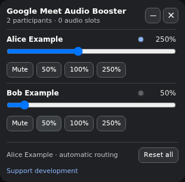

# Meet Audio Booster

Per-participant playback volume controls for Google Meet. Preferences stay in browser `localStorage`; the extension has no telemetry, makes no background network requests, and does not transmit meeting data.

## Install and use

[Install from the Chrome Web Store](https://chromewebstore.google.com/detail/meet-audio-booster/jhfekklmjikhcliimjcchapimohlmhaf). All extension functionality is free.

1. Install the extension in a supported Chromium browser, then reload any already-open Google Meet tab.
2. Join a Google Meet call and use each participant's slider or preset to adjust what **you** hear. Start at 100% and raise volume gradually.
3. Use the toolbar button to reopen a hidden panel; use Reset all to return the listed participants to 100%.



*Example controls shown with sample participants*

## Troubleshooting and support

- No panel: confirm the tab is on `meet.google.com`, reload after installing, and click the extension toolbar button.
- No participants: join the call and wait for remote participants. The extension cannot adjust your microphone or other people's playback.
- A setting seems inactive: speaker handoffs, overlapping speech, uncertain stream association and a hidden meeting tab deliberately fall back to 100%. Saved mute/gain is not guaranteed while the tab is hidden. Browser restrictions or meeting changes can also prevent audio interception; see the limitations below.
- Preferences: clear Google Meet site data to remove local settings; uninstalling alone may leave them behind.

[Get help or report an issue](https://github.com/andreclemente/meet-audio-booster/issues) · [Open a new issue](https://github.com/andreclemente/meet-audio-booster/issues/new). Include browser/extension versions and reproduction steps, not private meeting details or participant names.

Optional: [Buy Me a Coffee](https://buymeacoffee.com/andreclemente) to support development. Donations do not unlock features; all extension functionality remains free. Clicking the panel's Support development link opens this external site in a new tab under its own privacy policy and terms. No participant or meeting data is appended to the URL; the link uses `noopener noreferrer` and `no-referrer`. No support widget or request loads before you click.

## Features

- Per-participant 0–600% controls, mute, and presets
- Compatible storage under `__meeting_audio_booster_v15`, including panel position
- Draggable panel that can be restored with the extension toolbar button
- Collapse button immediately left of × hides the participant controls, reset footer, and status while keeping the header visible. The collapsed or expanded preference is saved locally per site alongside gain and panel-position settings and restored after reload; existing settings default to expanded. Toolbar hide/show preserves the current state, and toggling still works if storage is unavailable.
- Google Meet MAIN-world AudioWorklet interception (including Brave's pooled nodes) and Chromium media-element replay fallback
- JSON-serializable diagnostics from `window.__meetingAudioBoosterDebug()`

## Supported sites

The manifest is intentionally limited to `https://meet.google.com/*`. No additional hosts or permissions are requested.

## Development

Requires Node.js 20 or newer.

```sh
npm ci
npm run build
npm test
```

`npm run build` deterministically recreates `dist/` with the bundled MAIN-world script, service worker, manifest, and icons. `npm run watch` rebuilds the script while developing.

### Load unpacked

1. Run `npm ci && npm run build`.
2. Open `chrome://extensions`, enable **Developer mode**, and choose **Load unpacked**.
3. Select the generated `dist/` directory (not `src/`).
4. Join a supported meeting and use the panel. If it is hidden, click the toolbar action.

The repository root remains directly loadable for compatibility, but `dist/` is the release artifact.

## Architecture

- `src/storage.js`, `state.js`: compatible preferences and shared state
- `src/ui/`: panel, participant row, and styles
- `src/platforms/google-meet/`: strict roster discovery, targeted speaker detection, per-pipeline RMS/hysteresis, repeated exclusive association learning, pooled AudioWorklet handling, media replay, and conservative routing state machine
- `src/shared/`: constants, audio/DOM helpers, and safe diagnostics
- `scripts/build.mjs`: MV3 release assembly

Meet's pooled AudioWorklet outputs are deliberately never permanently assigned to people. A speaker handoff resets every output to 100% before a confirmed new setting is applied. Media stream association is learned only after repeated exclusive UI and energy agreement, never from array or DOM order. Ambiguous, stale, overlapping, or unknown observations route at 100%.

## Exact limitations

- Meeting applications can change undocumented DOM and Web Audio internals; participant/speaker selectors may require maintenance.
- Google Meet routing is conservative. During overlap, handoff confirmation, stale UI, unknown stream association, or while the meeting tab is hidden it intentionally uses 100%. Saved mute/gain is not guaranteed in a hidden tab.
- RMS indicates that a stream carries energy; it cannot identify a person until repeated exclusive alignment establishes an association.
- Audio protected by browser/platform restrictions or created before MAIN-world hooks can be unavailable for replay.
- Automated tests validate routing, storage, names, energy logic, build output, and MV3 policy, but real calls on current Google Meet builds still require manual browser testing.

## Privacy

Volume preferences, panel position and the collapsed/expanded preference are stored locally. See [privacy.md](privacy.md).

## License

[MIT](LICENSE) © 2026 André Clemente.
